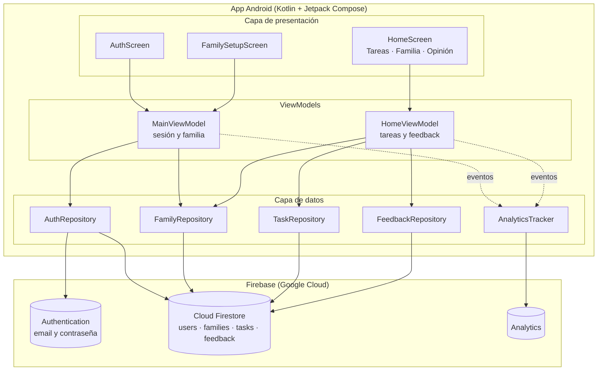
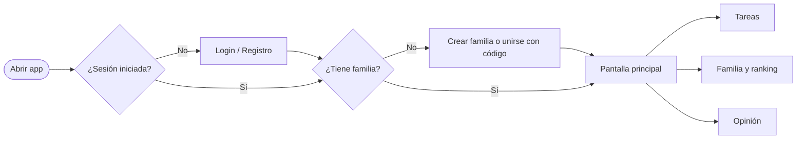

# TareasHogar — Guía completa del TP 2 (Build-Measure-Learn)

App Android nativa (Kotlin + Jetpack Compose + Firebase) para que una familia organice las tareas del hogar.

Esta guía reúne todo lo necesario para retomar el trabajo en otro momento: qué hace la app, cómo está organizada, cómo armar el proyecto paso a paso, cómo hacer las pruebas con usuarios y qué falta para la entrega.

---

## Índice

1. [Resumen de la consigna](#1-resumen-de-la-consigna)
2. [Qué hace la app (MVP)](#2-qué-hace-la-app-mvp)
3. [Qué hay en esta carpeta](#3-qué-hay-en-esta-carpeta)
4. [Arquitectura](#4-arquitectura)
5. [Paso a paso para armar el proyecto](#5-paso-a-paso-para-armar-el-proyecto)
6. [Cómo probar que funciona](#6-cómo-probar-que-funciona)
7. [Medición: dónde ver los datos](#7-medición-dónde-ver-los-datos)
8. [Pruebas con usuarios reales](#8-pruebas-con-usuarios-reales)
9. [Problemas comunes y soluciones](#9-problemas-comunes-y-soluciones)
10. [Checklist de entrega](#10-checklist-de-entrega)

---

## 1. Resumen de la consigna

- **Objetivo:** aplicar el ciclo Build-Measure-Learn construyendo un MVP de una app móvil nativa.
- **Herramientas:** Android Studio y Firebase (autenticación de usuarios obligatoria).
- **Fecha de entrega:** 01/10 (fecha del parcial).
- **Entregables:**
  1. Definición del MVP (con lista de requerimientos).
  2. Código del MVP.
  3. Resultados de las pruebas con usuarios reales y su análisis.
  4. Diagrama de arquitectura actualizado según los resultados.

---

## 2. Qué hace la app (MVP)

### Problema
En muchas casas las tareas domésticas se reparten "de palabra": nadie sabe bien qué falta hacer, a quién le toca ni quién viene colaborando más.

### Propuesta de valor
Una lista de tareas **compartida en tiempo real** por toda la familia, con responsables asignados y un ranking que motiva a participar.

### Hipótesis a validar con el MVP
1. Las familias quieren tener las tareas del hogar en una lista compartida.
2. Asignar un responsable a cada tarea reduce las discusiones sobre "a quién le toca".
3. El ranking de tareas completadas motiva a participar más.
4. La app es lo bastante simple como para usarla todas las semanas.

### Requerimientos funcionales (lo que ya está implementado)

| # | Requerimiento |
|---|---|
| RF1 | Registrarse e iniciar sesión con email y contraseña (Firebase Authentication). |
| RF2 | Crear un grupo familiar, que genera un código de invitación de 6 caracteres. |
| RF3 | Unirse a una familia existente ingresando el código. |
| RF4 | Compartir el código de invitación por WhatsApp, mail, etc. |
| RF5 | Crear una tarea con título, detalle opcional, categoría y responsable (o "cualquiera"). |
| RF6 | Marcar una tarea como hecha o volver a dejarla pendiente. |
| RF7 | Eliminar una tarea (con confirmación). |
| RF8 | Filtrar tareas: Pendientes, Mías, Todas, Hechas. |
| RF9 | Ver el progreso general (X de Y tareas completadas). |
| RF10 | Ver los integrantes de la familia y un ranking de tareas completadas. |
| RF11 | Salir de la familia. |
| RF12 | Enviar una opinión sobre la app (estrellas, "¿la usarías todas las semanas?" y comentario). |
| RF13 | Cerrar sesión. |

### Requerimientos no funcionales
- Sincronización en tiempo real entre los celulares de la familia (Firestore).
- Solo los miembros de una familia pueden ver y modificar sus tareas (reglas de seguridad de Firestore).
- Registro automático de eventos de uso con Firebase Analytics.
- Interfaz en español, con modo claro y oscuro.
- Android 7.0 (API 24) o superior.

### Fuera del MVP (ideas para versiones futuras)
Recordatorios y notificaciones push, tareas repetitivas (todos los lunes, etc.), fechas límite, puntos y premios, fotos de la tarea terminada, lista de compras separada, login con Google. Conviene decidir cuáles priorizar **según lo que digan los usuarios en las pruebas** (esa es la etapa "Learn").

---

## 3. Qué hay en esta carpeta

```
TareasHogar/
├── GUIA.md                     ← esta guía
├── CAMBIOS_GRADLE.txt          ← líneas para agregar a los build.gradle.kts del proyecto
├── firestore.rules             ← reglas de seguridad para pegar en Firebase
├── build.gradle.kts            ← (notas copiadas de la consola de Firebase, NO es un archivo completo)
├── app/build.gradle.kts        ← (ídem, son fragmentos de referencia)
└── app/src/main/java/com/example/tareashogar/
    ├── MainActivity.kt                 Punto de entrada. Inicia Analytics y muestra la app.
    ├── analytics/
    │   └── AnalyticsTracker.kt         Envía eventos a Firebase Analytics.
    ├── data/                           Capa de datos (habla con Firebase)
    │   ├── Models.kt                   Clases: AppUser, Family, HouseTask, TaskCategory.
    │   ├── FirestoreExtensions.kt      Convierte documentos de Firestore en objetos y escucha cambios en tiempo real.
    │   ├── AuthRepository.kt           Registro, login, logout y datos del usuario.
    │   ├── FamilyRepository.kt         Crear, unirse y salir de una familia; listar miembros.
    │   ├── TaskRepository.kt           Crear, completar y eliminar tareas.
    │   └── FeedbackRepository.kt       Guarda las opiniones de los usuarios.
    └── ui/                             Capa de presentación (pantallas)
        ├── AppRoot.kt                  Decide qué pantalla mostrar según la sesión.
        ├── MainViewModel.kt            Estado de sesión: cargando / sin login / sin familia / listo.
        ├── auth/AuthScreen.kt          Pantalla de login y registro.
        ├── family/FamilySetupScreen.kt Crear familia o unirse con código.
        ├── home/
        │   ├── HomeScreen.kt           Estructura principal: barra superior, pestañas inferiores, botón "Nueva tarea".
        │   ├── HomeViewModel.kt        Lógica de tareas, familia y feedback.
        │   ├── TasksContent.kt         Pestaña "Tareas": progreso, filtros y lista.
        │   ├── AddTaskDialog.kt        Diálogo para crear una tarea.
        │   ├── FamilyContent.kt        Pestaña "Familia": código de invitación y ranking.
        │   └── FeedbackContent.kt      Pestaña "Opinión": formulario de feedback.
        └── theme/Theme.kt              Colores de la app (verde y naranja, modo claro y oscuro).
```

> Los dos `build.gradle.kts` de esta carpeta son los fragmentos que da la consola de Firebase (tienen `...` en el medio). **No los copies enteros al proyecto**: usá `CAMBIOS_GRADLE.txt`, que ya tiene las mismas versiones (plugin `4.5.0` y BoM `34.19.0`) más las demás dependencias que necesita el código.

---

## 4. Arquitectura

Patrón **MVVM** (Model-View-ViewModel) con repositorios:

- **View (Compose):** las pantallas solo muestran datos y avisan las acciones del usuario.
- **ViewModel:** guarda el estado de la pantalla y decide qué hacer con cada acción.
- **Repository:** es el único que habla con Firebase. Si mañana se cambia Firebase por otro backend, solo se tocan los repositorios.
- **Firebase:** Authentication (usuarios), Firestore (datos en tiempo real) y Analytics (métricas de uso).

### Diagrama de arquitectura (versión MVP)

> Se ve como diagrama en GitHub, en Cursor/VS Code con una extensión de Mermaid, o pegándolo en [mermaid.live](https://mermaid.live) para exportarlo como imagen.



### Modelo de datos en Firestore

```
users/{uid}
    name, email, familyId, createdAt

families/{familyId}
    name, inviteCode, members[uid...], createdBy, createdAt

    tasks/{taskId}          (subcolección de cada familia)
        title, description, category, assignedTo, assignedName,
        done, createdBy, createdAt, completedBy, completedAt

feedback/{id}
    uid, userName, familyId, rating (1-5), wouldUseWeekly (Sí/Tal vez/No),
    comment, tasksInFamily, device, androidVersion, createdAt
```

### Flujo de la app



---

## 5. Paso a paso para armar el proyecto

### Paso 1 — Crear el proyecto en Android Studio
1. **File > New > New Project > Empty Activity** (la que tiene el ícono de Compose).
2. Completar:
   - **Name:** `TareasHogar`
   - **Package name:** `com.example.tareashogar`
   - **Language:** Kotlin
   - **Minimum SDK:** API 24
   - **Build configuration language:** Kotlin DSL (`build.gradle.kts`)
3. **Finish** y esperar a que termine de sincronizar Gradle.
4. Ejecutar una vez la app vacía (botón ▶) para confirmar que el proyecto compila antes de tocar nada.

> Si usás otro nombre de paquete, tenés que cambiar la primera línea (`package ...`) de todos los archivos `.kt` y los `import com.example.tareashogar...`.

### Paso 2 — Crear el proyecto en Firebase
1. Entrar a [console.firebase.google.com](https://console.firebase.google.com) > **Agregar proyecto** (dejar Google Analytics **activado**).
2. En el proyecto: **Agregar app > Android**.
   - **Nombre del paquete:** `com.example.tareashogar` (tiene que ser idéntico al del Paso 1).
   - El SHA-1 no hace falta para email/contraseña.
3. Descargar **`google-services.json`** y copiarlo a la carpeta `app/` del proyecto (queda al lado de `app/build.gradle.kts`, **no** dentro de `src`).
   - En Android Studio, cambiá la vista del panel izquierdo de "Android" a **"Project"** para ver la carpeta `app/` real.
4. Los pasos de "agregar el SDK" que muestra Firebase se resuelven en el Paso 4 de esta guía.

### Paso 3 — Activar Authentication y Firestore
1. **Authentication > Comenzar > Método de acceso > Correo electrónico/contraseña > Habilitar > Guardar.**
2. **Firestore Database > Crear base de datos.**
   - Ubicación: la más cercana (por ejemplo `southamerica-east1` o `us-central`).
   - Modo: cualquiera, porque en el paso siguiente se reemplazan las reglas.
3. En **Firestore > Reglas**, borrar todo, pegar el contenido de `firestore.rules` y tocar **Publicar**.

### Paso 4 — Gradle (dependencias)
Abrir `CAMBIOS_GRADLE.txt` y **agregar** (no reemplazar) las líneas indicadas en:
- `build.gradle.kts` de la **raíz** del proyecto: plugin de Google Services con `apply false`.
- `app/build.gradle.kts`: el plugin de Google Services y las dependencias:
  - Firebase BoM + `firebase-auth`, `firebase-firestore`, `firebase-analytics`
  - `kotlinx-coroutines-play-services`
  - `lifecycle-viewmodel-compose`
  - `material-icons-core`

Tocar **Sync Now** en la barra amarilla que aparece arriba.

> Si el proyecto usa un catálogo de versiones (`gradle/libs.versions.toml`), igual podés pegar las dependencias como texto (`"grupo:nombre:versión"`); Android Studio puede sugerir moverlas al catálogo, pero no es obligatorio.

### Paso 5 — Copiar el código
En el panel izquierdo, abrir `app/src/main/java/com/example/tareashogar/` y:

1. **Reemplazar** el contenido de `MainActivity.kt` por el de esta carpeta.
2. **Reemplazar** el contenido de `ui/theme/Theme.kt` por el de esta carpeta.
   - `Color.kt` y `Type.kt` (generados por la plantilla) pueden quedar, no molestan.
3. **Copiar** las carpetas `analytics/` y `data/`, y los archivos de `ui/` (`AppRoot.kt`, `MainViewModel.kt`, y las carpetas `auth/`, `family/` y `home/`).

Lo más rápido es copiar las carpetas desde el Explorador de Windows directamente a:
`<tu proyecto>\app\src\main\java\com\example\tareashogar\`

### Paso 6 — Compilar y ejecutar
1. **Build > Rebuild Project.**
2. Si aparecen errores, ver la sección [Problemas comunes](#9-problemas-comunes-y-soluciones).
3. Ejecutar ▶ en un emulador o en un celular con la depuración USB activada.

---

## 6. Cómo probar que funciona

Hacerlo antes de mostrarle la app a usuarios reales:

1. **Registro:** crear una cuenta (nombre, email, contraseña de 6 caracteres o más).
   - En Firebase > Authentication > Usuarios tiene que aparecer el usuario.
2. **Crear familia:** ponerle un nombre, por ejemplo "Familia Prueba".
   - En Firestore tienen que aparecer `users/{uid}` y `families/{id}`.
3. **Crear tareas:** usar distintas categorías y responsables.
4. **Segunda cuenta:** en otro dispositivo (o cerrando sesión), registrar otra cuenta y **unirse con el código** que figura en la pestaña Familia.
5. **Tiempo real:** marcar una tarea como hecha en un dispositivo y verificar que se actualiza sola en el otro.
6. **Filtros y ranking:** revisar "Mías", "Hechas" y el ranking en la pestaña Familia.
7. **Opinión:** enviar un feedback y verificar que aparece en Firestore > `feedback`.
8. **Salir de la familia y cerrar sesión.**

---

## 7. Medición: dónde ver los datos

### Firebase Analytics (uso de la app)
La app registra estos eventos automáticamente:

| Evento | Cuándo se dispara | Datos extra |
|---|---|---|
| `sign_up` | Alguien se registra | — |
| `login` | Alguien inicia sesión | — |
| `family_created` | Se crea una familia | — |
| `family_joined` | Alguien se une con código | — |
| `family_left` | Alguien sale de una familia | — |
| `invite_shared` | Se comparte el código | — |
| `task_created` | Se crea una tarea | `category`, `assigned` |
| `task_completed` | Se marca una tarea como hecha | `category`, `was_assigned_to_me` |
| `task_deleted` | Se elimina una tarea | — |
| `feedback_sent` | Se envía una opinión | `rating` |

**Dónde verlos:**
- **Analytics > Events:** los datos aparecen con hasta 24 h de demora.
- **Analytics > DebugView:** en tiempo real, ideal para probar. Para activarlo, con el celular o emulador conectado, correr en la terminal:
  ```
  adb shell setprop debug.firebase.analytics.app com.example.tareashogar
  ```
  (para desactivarlo: `adb shell setprop debug.firebase.analytics.app .none.`)

### Firestore (datos concretos)
- **`feedback`:** todas las opiniones de los usuarios.
- **`families/{id}/tasks`:** cuántas tareas creó cada familia, cuántas completó y quién.

### Métricas sugeridas para el análisis

| Métrica | Cómo se calcula | Qué hipótesis valida |
|---|---|---|
| Tasa de activación | Usuarios que crearon o se unieron a una familia / registrados | ¿Entienden el concepto? |
| Invitación | Familias con 2 o más miembros / familias creadas | ¿Lo quieren compartir? (H1) |
| Tareas por familia | Promedio de `task_created` por familia | ¿Le encuentran uso? (H1) |
| Tasa de completado | `task_completed` / `task_created` | ¿Realmente la usan para organizarse? (H2) |
| Tareas con responsable | % de `task_created` con `assigned = true` | ¿Sirve asignar? (H2) |
| Satisfacción | Promedio de `rating` en `feedback` | Valoración general |
| Intención de uso | % de "Sí" en `wouldUseWeekly` | ¿La usarían seguido? (H4) |

---

## 8. Pruebas con usuarios reales

### Preparación
- Instalar la app en los celulares de los participantes. La forma más simple es generar el APK (**Build > Build App Bundle(s) / APK(s) > Build APK(s)**) y pasárselo por WhatsApp o Drive; hay que permitir "instalar apps de origen desconocido".
- Ideal: **al menos 2 familias** (o 1 familia con 3 o 4 personas) usando la app **varios días**.

### Guion de la prueba (unos 15 minutos por persona)
1. Explicar en una frase qué es la app, **sin mostrar cómo se usa**.
2. Pedirle que haga estas tareas solo, mientras observás y anotás dónde duda o se traba:
   1. Registrarse.
   2. Crear una familia (o unirse con el código que le pases).
   3. Invitar a otro integrante.
   4. Crear 3 tareas asignadas a distintas personas.
   5. Marcar una tarea como hecha.
   6. Encontrar quién completó más tareas.
3. Pedirle que complete la pestaña **Opinión** dentro de la app.
4. Preguntas abiertas (anotar las respuestas textuales):
   - ¿Hoy cómo organizan las tareas en tu casa?
   - ¿Qué fue lo más fácil y lo más difícil de usar?
   - ¿Qué le agregarías para usarla de verdad?
   - ¿Tu familia la usaría? ¿Por qué sí o por qué no?
   - Del 1 al 10, ¿qué tan probable es que se la recomiendes a alguien?

### Planilla sugerida para registrar resultados

| Usuario | Edad / rol en la familia | ¿Completó las tareas sin ayuda? | Dónde se trabó | Estrellas | ¿La usaría semanalmente? | Comentarios / pedidos |
|---|---|---|---|---|---|---|
| U1 | | | | | | |
| U2 | | | | | | |
| U3 | | | | | | |

### Análisis (etapa "Learn")
Con la planilla, el feedback de Firestore y los eventos de Analytics:
1. Para cada hipótesis de la sección 2, anotar si se **validó**, se **refutó** o quedó **sin datos suficientes**.
2. Listar los problemas de usabilidad encontrados y cuántos usuarios los tuvieron.
3. Listar las funcionalidades pedidas y cuántas veces se pidió cada una.
4. Decidir: **perseverar** (mejorar lo que hay) o **pivotar** (cambiar el enfoque), y qué entra en la próxima versión.

### Diagrama de arquitectura actualizado (entregable 4)
Después del análisis hay que agregar al diagrama de la sección 4 los componentes que surgieron de las pruebas. Ejemplos típicos para esta app:
- **Firebase Cloud Messaging (FCM):** notificaciones de "te asignaron una tarea" o "tenés tareas pendientes".
- **Cloud Functions:** tareas repetitivas automáticas y recordatorios programados.
- **Crashlytics:** para detectar errores en los celulares de los usuarios.
- **Remote Config / A/B Testing:** para probar variantes (por ejemplo, con y sin ranking) sin publicar otra versión.
- **Google Sign-In:** si los usuarios se quejan de tener que crear contraseña.
- **Room (base local):** si piden usar la app sin conexión de forma más robusta.

Marcar en el diagrama cuáles son componentes **nuevos** (por ejemplo, con otro color o con la etiqueta "v2").

---

## 9. Problemas comunes y soluciones

| Problema | Causa probable | Solución |
|---|---|---|
| `File google-services.json is missing` | El archivo no está en `app/` | Copiarlo a `app/google-services.json` (vista "Project" en Android Studio). |
| `No matching client found for package name` | El paquete del proyecto no coincide con el registrado en Firebase | Registrar otra app en Firebase con el paquete correcto y volver a descargar el json. |
| `Unresolved reference: await` | Falta la dependencia de corrutinas | Agregar `kotlinx-coroutines-play-services` y sincronizar. |
| `Unresolved reference: viewModel` | Falta la dependencia de lifecycle | Agregar `lifecycle-viewmodel-compose`. |
| `Unresolved reference: Icons` / `Share` / `Star` | Faltan los íconos | Agregar `material-icons-core`. |
| `Unresolved reference: TareasHogarTheme` | No se reemplazó `Theme.kt` o el paquete es distinto | Reemplazar `ui/theme/Theme.kt` y revisar la línea `package`. |
| Error de `package` o `import com.example.tareashogar` | El proyecto tiene otro nombre de paquete | Cambiar `package` e `import` en todos los archivos (clic derecho en la carpeta > Refactor > Rename). |
| "Conflicting declarations" en `Theme.kt` | Quedaron dos archivos con la misma función | Dejar un solo `Theme.kt` (el de esta carpeta). |
| Al registrarse: "Ocurrió un error inesperado" / `CONFIGURATION_NOT_FOUND` | No se habilitó email/contraseña | Paso 3.1 de esta guía. |
| La app queda cargando o no muestra tareas | Firestore no creado o reglas no publicadas | Paso 3.2 y 3.3. Revisar **Logcat** filtrando por `Firestore`. |
| `PERMISSION_DENIED` en Logcat | Reglas incorrectas | Volver a pegar `firestore.rules` y **Publicar**. (Al cerrar sesión es normal que aparezca una vez.) |
| "No existe ninguna familia con ese código" | Código mal escrito | El código no usa 0, O, 1 ni I; copiarlo desde "Compartir código". |
| Los eventos no aparecen en Analytics | Demoran hasta 24 h | Usar DebugView (sección 7). |
| El emulador no tiene internet | Problema del emulador | Cold Boot del emulador desde Device Manager, o probar en un celular real. |

---

## 10. Checklist de entrega

### Código (entregable 2)
- [ ] Proyecto creado en Android Studio con el paquete `com.example.tareashogar`
- [ ] Proyecto de Firebase creado y `google-services.json` en `app/`
- [ ] Authentication (email/contraseña) habilitado
- [ ] Firestore creado y reglas publicadas
- [ ] Dependencias de `CAMBIOS_GRADLE.txt` agregadas y sincronizadas
- [ ] Código copiado y compilando
- [ ] Probado con 2 cuentas en tiempo real (sección 6)
- [ ] Código subido a GitHub o comprimido en .zip para entregar (**sin** subir `google-services.json` a un repo público)

### Definición del MVP (entregable 1)
- [ ] Problema, propuesta de valor e hipótesis (sección 2)
- [ ] Lista de requerimientos funcionales y no funcionales (sección 2)
- [ ] Qué quedó fuera del MVP y por qué

### Pruebas y análisis (entregable 3)
- [ ] APK instalado en celulares de usuarios reales
- [ ] Pruebas hechas con el guion (sección 8)
- [ ] Planilla de resultados completa
- [ ] Capturas de Analytics (Events o DebugView) y de la colección `feedback`
- [ ] Análisis: hipótesis validadas o refutadas, problemas y pedidos
- [ ] Decisión: perseverar o pivotar, y próximos pasos

### Arquitectura (entregable 4)
- [ ] Diagrama del MVP (sección 4)
- [ ] Diagrama actualizado con los componentes nuevos según las pruebas
